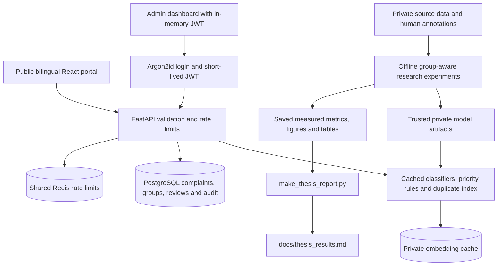

# BanglaPSG — Multilingual complaint research and demo portal

A local, reproducible data preparation pipeline for Bangla, English and Banglish
complaints. Use Python 3.12 for the pinned deployment environment and Node
22.12+ for the frontend. The source-code ZIP excludes research data.
Use the archive importer below or place your CSV at
`ml_training/data/raw/banglapsg.csv`.

This repository includes **Phase 1** preparation, **Phase 2** multilingual
data creation, duplicate candidate generation and local human annotation, and
**Phase 3** classification/severity experiments with calibration diagnostics,
**Phase 4** cross-language location/time-aware duplicate detection, and
**Phase 5** priority rules/ranking, explanations, uncertainty and fairness audits,
**Phase 6** a persistent FastAPI backend with administrator review and feedback,
**Phase 7** a bilingual public and administrator frontend, and **Phase 8**
container/deployment instructions, security hardening and thesis reporting.
Start with the setup below, then follow the complete
[Phase 2 workflow](docs/phase2_workflow.md) and
[annotation guideline](docs/annotation_guideline.md).
For models, follow the [Phase 3 training and evaluation guide](docs/phase3_workflow.md).
Duplicate experiments have [exact commands](docs/phase4_workflow.md) and a
[prespecified design and validity discussion](docs/duplicate_experiment_design.md).
Priority analysis has a [Phase 5 workflow](docs/phase5_workflow.md) and
[evaluation design](docs/priority_experiment_design.md).
Backend setup, API contracts and deployment limits are documented in the
[Phase 6 backend guide](docs/phase6_backend.md).

This is an AI decision-support demo, not an official government system.
No model-quality scores are bundled. Missing trained artifacts produce an
explicit human-review fallback in development; strict production mode refuses
to start until its required models and services are ready.

## Security upgrade and deployment

Before upgrading an existing deployment: new complaint/preview text is limited
to **1,000 characters**; legacy PBKDF2 administrator hashes must be regenerated
as **Argon2id**; production API documentation is disabled. Existing complaint
rows are retained. The administrator token defaults to 30 minutes and cannot
exceed 60 minutes. Default per-IP limits are 5 submissions, 10 analyses and
3 login attempts per minute. Deployment environment variables use the actual
`BACKEND_` prefix, including `BACKEND_JWT_SECRET`.

The [filled security checklist](docs/security_checklist.md) separates verified
local behavior from unfinished hosting controls. Read the
[actual dependency findings](docs/security/dependency_audit.md) and
[privacy/retention runbook](docs/data_retention.md). Optional phone/email is
stored separately from complaint text and omitted from public receipts,
tracking, ML records and feedback exports. Publish the operator name/privacy
contact before accepting personal information. Reviewed deletion is available
through `scripts/delete_data.py` and the protected `/admin/data-deletion`
preview/apply endpoint; backups, exports and separately trained models still
require the operator's documented process.

For local PostgreSQL + Redis + API containers, install Docker Compose 2.30+
and follow the [container guide](docs/containers.md):

```powershell
python -m pip install -r requirements-backend.txt
python -m deploy.configure_local
docker compose up --build --wait api
```

The helper writes ignored private environment files without printing secrets.
Compose defaults to the smaller rule/TF-IDF `runtime-lite` image. The Dockerfile
also supplies a CPU-only neural `runtime` target with pinned wheels and hashes.
Docker execution, hosting resource fit and production infrastructure must be
verified on the actual target; the supplied files are not a deployment claim.
The [deployment guide](docs/deployment.md) covers Neon/Supabase, Render,
Hugging Face Spaces, Vercel, CORS, health checks, cold starts and current free-plan
constraints. Account eligibility, quotas and provider policies can change.

## Architecture



## Thesis results and writing support

Run experiments using the phase guides, then collect their saved outputs:

```powershell
python make_thesis_report.py --overwrite
```

This reads `results/` and writes `docs/thesis_results.md`; it does not train
models or invent measurements. An empty results directory produces an explicit
awaiting-experiments report; a missing directory produces a clear error.
Review any private prediction/error exports before sharing the report or linked
files. Use the [chapter outline](docs/thesis_outline.md),
[research questions mapped to experiments](docs/research_questions.md) and
[validity, limitations and ethics guidance](docs/thesis_validity_ethics.md)
to report the measured findings, including a proposed method that does not
outperform its baseline.

## Phase 7 quick start

Start the backend using the next section, including `python -m alembic upgrade head`.
Then, in a second terminal from the repository root:

```powershell
Set-Location frontend
npm ci
# Fresh checkout only; preserve an existing frontend .env:
Copy-Item .env.example .env
npm run dev
```

Use the local URL printed by Vite. The default `/api` URL forwards to the local
FastAPI backend. The public interface submits complaints and tracks their
limited status summary; the administrator dashboard reviews priorities and
duplicate groups, with English/বাংলা controls and live operational charts.
Optional contact information is private to administrators; this phase does
not send notifications. See the [complete frontend guide](docs/phase7_frontend.md)
for API configuration, privacy, review workflows and static deployment.

```powershell
# From frontend/:
npm test
npm run build
npm run preview
```

## Phase 6 quick start

Run from the repository root in your virtual environment:

```powershell
python -m pip install -r requirements-backend.txt
# Fresh checkout only; preserve an existing .env:
Copy-Item .env.example .env
python scripts/create_admin.py --username admin
# Privately copy assignments from the new ignored .env.admin file into .env.
python -m alembic upgrade head
python -m uvicorn backend.app:create_app --factory --host 127.0.0.1 --port 8000 --no-proxy-headers
```

In development, open [Swagger UI](http://127.0.0.1:8000/docs) or import
`backend/postman_collection.json` and `backend/postman_environment.json`.
Citizens can submit anonymously. Administrator JWTs protect complaint reads
and review actions by default. Reviews require a reason and current record
version; overrides retain the original automatic analysis and become feedback.

Development permits missing ML artifacts and explicitly requests human review.
Automatic multilingual grouping requires your trained, validated duplicate
artifact. Production mode requires PostgreSQL, shared Redis and ready artifacts.
The guide explains model startup, privacy, concurrency and verification limits.

```powershell
python -m pytest -q
python -m backend.scripts.export_feedback --output backend/exports/admin_feedback.jsonl
```

Exports are private review events for adjudication before retraining. Omission
of the raw `text` column does not anonymize reasons or model explanations.

## Phase 5 quick start

```python
from ml.analysis import analyze_complaint

result = analyze_complaint(
    "মিরপুর ১০ এ ৩ দিন ধরে পানি নেই",
    location="Mirpur 10",
    timestamp="2026-10-30T10:00:00+06:00",
)
print(result)
```

Without trained category/severity artifacts and a compatible validation-selected
review policy, their predictions/confidence remain unavailable and the result
is marked `needs_human_review`. Transparent keyword/duration rules still explain
their contributions. No labels or confidence values are invented.

```powershell
python -m ml_training.scripts.analyze_complaints --text "pani nai 3 din dhore"
python -m pytest -q
```

Edit `config/priority_rules.yaml` to configure points, weights, multilingual
keywords, duration/report-volume bands and priority labels. Duplicate volume
counts distinct source reports, not people affected. Source severity, rule
points, expert 1–5 judgments, learned ranking utility and calibrated classifier
confidence are separate quantities.

The Phase 5 guide covers validation export, model/resource-bound review policy,
batch analysis, explanations and area/language audits. Optional pairwise-logistic
ranking learns from expert queue judgments in
`templates/expert_priority_judgments.csv`; insufficient data produces an explicit
rules fallback. Comparisons use identical held-out query items for NDCG@5 and
Spearman. The template is empty; no expert judgments or ranking/fairness results
are supplied.

## Import the supplied datasets

For a fresh checkout, run the following commands. The supplied archives have
already been imported and prepared in this workspace; existing data files are
protected against accidental replacement.

```powershell
python -m pip install -r requirements.txt
python -m ml_training.scripts.import_research_datasets --banglapsg-zip "C:\Users\hasib\Downloads\BanglaPSG A Bangla Public Service Grievance Datase (2).zip" --bangladual-zip "C:\Users\hasib\Downloads\BanglaDual A 1.24-Million Pair Multi-Source Datase.zip"
python -m ml_training.scripts.prepare_data
```

The importer maps the observed workbook headers, retains source provenance,
and preserves actual labels. BanglaDual samples stay in a separate auxiliary
language file with `is_incident_gold=false`. The full original archive is
inventoried, not expanded into a large duplicate of the supplied data.
See [dataset sources and import semantics](docs/dataset_sources.md). Unknown
incident identity, location, and timestamps require review; they are not filled
with invented values. Actual BanglaPSG severity labels are `Low Medium High`.
See [the current workspace readiness record](docs/current_workspace.md) for
what is present locally and which annotation/translation steps remain.

## Phase 4 quick start

Prepare an adjudicated `pair_id,gold_label` table, preserving independent
annotations, then attach it to the Phase 2 candidates:

```powershell
python -m ml_training.scripts.apply_duplicate_labels --labels adjudicated_pairs.csv
python -m pip install -r requirements-embeddings.txt
python -m ml_training.scripts.train_duplicates --pairs ml_training/data/pairs_gold --complaints ml_training/data/multilingual/train.csv --complaints ml_training/data/multilingual/val.csv --complaints ml_training/data/multilingual/test.csv --allow-download
python -m ml_training.scripts.analyze_duplicate_errors --predictions results/duplicates/P2/test/predictions.csv --output-dir results/duplicates/P2/error_analysis
python -m ml_training.scripts.cluster_duplicates --predictions results/duplicates/P2/test/predictions.csv --all-complaints ml_training/data/multilingual/test.csv --output results/duplicates/P2/test/clusters.csv
```

The all-model run includes B1, B2, P1, P2 and the extra C0 attribution control.
Thresholds use validation only; all models evaluate identical test pairs.
For cached/offline weights, omit `--allow-download` and supply
`--embedding-model path/to/local/minilm`. Run `--models B1` for the lightweight
TF-IDF-only baseline. Include any manually imported paraphrase CSV through an
additional `--complaints` argument. Generated labels require the explicit
`--allow-weak-labels` smoke-test flag and cannot substantiate a gold-label claim.
The complete workflow explains missingness, category-oracle sensitivity,
pair-type/language metrics, production retrieval, and clustering limitations.

## Phase 3 quick start

Install `requirements.txt` for the CPU TF-IDF models. Install
`requirements-embeddings.txt` as well for the MiniLM experiments. Replace the
severity labels below with your exact labels, ordered from least to most severe:

```powershell
python -m pip install -r requirements.txt
python -m ml_training.scripts.train_classifiers --models char_svm word_lr --severity-order low medium high

# MiniLM: use a locally cached encoder or an exported local model directory.
python -m pip install -r requirements-embeddings.txt
python -m ml_training.scripts.train_classifiers --severity-order low medium high --embedding-model path/to/local/minilm --results-dir results/full-run --artifacts-dir artifacts/full-run
```

Add `--natural-test path/to/collected.csv` to evaluate independent natural data.
Its five-column template supports category evaluation; severity evaluation also
requires reviewed `severity` values. Missing labels produce explicit skipped
results. Pretrained downloads require `--allow-download` explicitly.

The scripts print measured metrics and write `metrics.json`, a thesis table CSV,
classification reports, confusion matrix PNGs, reliability diagrams, and joblib
models. No performance scores are supplied in this repository. Optional XLM-R
training is separate; see `requirements-xlmr.txt` and the Phase 3 guide.

## Repository structure

```text
banglapsg/
├── .env.example
├── .gitignore
├── requirements.txt
├── requirements-embeddings.txt
├── requirements-xlmr.txt
├── pytest.ini
├── README.md
├── config/
│   └── priority_rules.yaml
├── annotation/
│   ├── __init__.py
│   ├── app.py
│   ├── agreement.py
│   └── index.html
├── templates/
│   ├── natural_test_set.csv
│   ├── manual_paraphrases.csv
│   └── expert_priority_judgments.csv
├── docs/
│   ├── data_schema.md
│   ├── annotation_guideline.md
│   ├── phase2_workflow.md
│   ├── phase3_workflow.md
│   ├── phase4_workflow.md
│   ├── duplicate_experiment_design.md
│   ├── dataset_sources.md
│   ├── current_workspace.md
│   ├── phase5_workflow.md
│   ├── priority_experiment_design.md
│   └── column_mapping.example.json
├── ml/
│   ├── __init__.py
│   ├── normalize.py
│   ├── noise.py
│   ├── transliterate.py
│   ├── location.py
│   ├── location_gazetteer.json
│   ├── time_features.py
│   ├── duplicate_features.py
│   ├── duplicate_index.py
│   ├── classifier_runtime.py
│   ├── priority_rules.py
│   ├── priority_ranker.py
│   ├── uncertainty.py
│   ├── analysis.py
│   └── banglish_variants.json
├── ml_training/
│   ├── __init__.py
│   ├── config.py
│   ├── splitting.py
│   ├── experiment_data.py
│   ├── modeling.py
│   ├── evaluation.py
│   ├── duplicate_data.py
│   ├── duplicate_metrics.py
│   ├── scripts/
│   │   ├── __init__.py
│   │   ├── prepare_data.py
│   │   ├── build_multilingual_set.py
│   │   ├── generate_pairs.py
│   │   ├── train_classifiers.py
│   │   ├── predict_classifiers.py
│   │   ├── finetune_xlmr.py
│   │   ├── import_research_datasets.py
│   │   ├── apply_duplicate_labels.py
│   │   ├── train_duplicates.py
│   │   ├── analyze_duplicate_errors.py
│   │   ├── cluster_duplicates.py
│   │   ├── export_validation_predictions.py
│   │   ├── select_review_threshold.py
│   │   ├── train_priority_ranker.py
│   │   ├── analyze_complaints.py
│   │   └── check_priority_fairness.py
│   ├── data/
│   │   ├── raw/.gitkeep
│   │   ├── interim/.gitkeep
│   │   ├── processed/.gitkeep
│   │   ├── multilingual/.gitkeep
│   │   ├── pairs/.gitkeep
│   │   ├── natural_test/.gitkeep
│   │   ├── pairs_gold/.gitkeep
│   │   └── auxiliary/.gitkeep
│   └── artifacts/.gitkeep
├── artifacts/.gitkeep
├── results/.gitkeep
└── tests/
    ├── test_normalize.py
    ├── test_prepare_data.py
    ├── test_splitting.py
    ├── test_multilingual.py
    ├── test_pairs.py
    ├── test_annotation.py
    ├── test_modeling.py
    ├── test_evaluation.py
    ├── test_experiment_data.py
    ├── test_train_classifiers.py
    ├── test_xlmr_helpers.py
    ├── test_geo_time.py
    ├── test_duplicate_features.py
    ├── test_duplicate_evaluation.py
    ├── test_duplicate_index.py
    ├── test_train_duplicates.py
    ├── test_apply_duplicate_labels.py
    ├── test_dataset_import.py
    ├── test_priority_rules.py
    ├── test_priority_ranker.py
    ├── test_uncertainty_fairness.py
    ├── test_complaint_analysis.py
    ├── test_validation_export.py
    ├── test_analysis_workflow.py
    └── test_runtime_embeddings.py
```

Raw data, generated data, model artifacts, local environments and `.env` are
ignored by Git. `interim/` is reserved for intermediate data; trained artifacts
are produced only by explicit training runs. This folder is ready for `git init`
if desired.

## Phase 2 quick start

After Phase 1 produces CSV splits, run these commands in the virtual environment.
Replace `100` with your desired number of original Bangla incident groups:

```powershell
python -m ml_training.scripts.build_multilingual_set export --sample-size 100
Copy-Item ml_training/data/multilingual/translation_queue.csv ml_training/data/multilingual/filled.csv
# Fill ONLY english_text in filled.csv using your translation tool, then review.
python -m ml_training.scripts.build_multilingual_set import --translations ml_training/data/multilingual/filled.csv
python -m ml_training.scripts.generate_pairs --max-pairs-per-type 1000
python -m annotation.app --pairs ml_training/data/pairs/pairs.csv --complaints ml_training/data/multilingual/train.csv --complaints ml_training/data/multilingual/val.csv --complaints ml_training/data/multilingual/test.csv
```

Open [the local annotation workspace](http://127.0.0.1:8000). Two annotators
use different stable IDs and independently label overlapping items. Duplicate
decisions and individual-complaint priority scores both require reasons.
The Agreement tab reports Cohen's kappa, and the CSV export preserves each
annotator's labels and reasons. Predictions are hidden during annotation.

All created Banglish and English rows are marked `is_derived=true` and retain
their incident's original split. Natural collection uses the header-only
`templates/natural_test_set.csv` and stays separate from derived evaluation
data. See the workflow for manual paraphrases, schema details, sample output,
natural-set annotation, and adjudicating a final gold dataset.

## Setup and commands

Run these commands in the repository folder. On Windows PowerShell:

```powershell
python -m venv .venv
.\.venv\Scripts\python.exe -m pip install -r requirements.txt
Copy-Item .env.example .env

# First place your CSV in ml_training/data/raw/banglapsg.csv.
.\.venv\Scripts\python.exe -m ml_training.scripts.prepare_data
.\.venv\Scripts\python.exe -m pytest -q
```

On macOS/Linux:

```bash
python3 -m venv .venv
.venv/bin/python -m pip install -r requirements.txt
cp .env.example .env
# First place your CSV in ml_training/data/raw/banglapsg.csv.
.venv/bin/python -m ml_training.scripts.prepare_data
.venv/bin/python -m pytest -q
```

`.env` is loaded automatically from the repository root. Existing environment
variables take precedence over `.env`; command-line flags take precedence over
both. Relative CLI and environment paths resolve from the repository root, so
direct script execution also works from other working directories.

Additional commands (use your virtual environment's Python):

```bash
python ml_training/scripts/prepare_data.py --help
python -m ml_training.scripts.prepare_data --input path/to/input.csv --format csv
python -m ml_training.scripts.prepare_data --format parquet --output-dir ml_training/data/processed/run-02
python -m ml_training.scripts.prepare_data --seed 123 --overwrite
python -m ml_training.scripts.prepare_data --column-map docs/column_mapping.example.json
python -m ml_training.scripts.prepare_data --variants ml/banglish_variants.json
```

The mapping example expects `complaint_text`, `label`, `priority`, and optional
`parent_id` source headers. Use it only when those match your CSV. Existing
outputs are protected unless `--overwrite` is passed; overwriting also removes
obsolete CSV/Parquet split formats from that output directory. Writes are staged
before replacement, but the whole multi-file set is not a filesystem transaction.
Avoid concurrent runs targeting the same output folder.

## Input and mapping

Minimum accepted UTF-8 CSV:

```csv
text,category,severity
"পানি নেই ২ দিন",water,high
"Street light broken",electricity,medium
```

For related records and explicit Banglish normalization, include optional
metadata (see [the complete schema](docs/data_schema.md)):

```csv
id,original_id,text,lang,category,severity,source_type,location,timestamp
001,case-1,"PANY NEI ২ din https://example.com",banglish,water,high,banglapsg,Dhaka,2026-01-01T12:00:00+06:00
002,case-1,"পানি নেই ২ দিন",bn,water,high,banglapsg,Dhaka,2026-01-01T12:00:00+06:00
```

These two rows stay in the same split. A tiny example cannot produce useful
70/15/15 partitions; real splits need enough independent groups per category.

Edit the canonical-name → source-header dictionary in `ml_training/config.py`
when your headers differ:

```python
COLUMN_MAPPING = {
    "id": "id",
    "original_id": "parent_id",
    "text": "complaint_text",
    "lang": "lang",
    "category": "label",
    "severity": "priority",
    "source_type": "source_type",
    "location": "location",
    "timestamp": "timestamp",
}
```

Alternatively pass a JSON file containing just the mapping overrides. Required
source columns are `text`, `category`, and `severity` under their mapped headers.
Missing columns, blank labels, invalid language tags/timestamps, duplicate IDs,
and text emptied by cleaning fail clearly. No rows are silently dropped. CSV
values such as `NA` are retained as literal strings, not interpreted as missing
data. A valid severity is any nonempty string; this phase does not invent labels.
Extra source columns are not exported.

Example error (exit code 2):

```text
ERROR: Missing required CSV columns: 'severity' -> 'severity'. Available headers: ['text', 'category']. Edit COLUMN_MAPPING in ml_training/config.py or pass --column-map mapping.json.
```

## Cleaning and language handling

All text receives NFKC normalization, Bangla-to-English digit conversion, URL
removal (`http://`, `https://`, `www.`), whitespace cleanup and lowercasing.
Empty cleaned text is rejected.

Banglish normalization additionally collapses runs of three or more identical
ASCII letters and applies the spelling dictionary. Ordinary double letters are
preserved; known double-letter variants are handled through the dictionary.

```python
from ml.normalize import clean_text, normalize_banglish

assert clean_text("  পানি  ১২ https://example.com  TEST ") == "পানি 12 test"
assert normalize_banglish("PANY NEI biddut paniiii") == "pani nai bidyut pani"
```

Extend `ml/banglish_variants.json` with lowercase alias → canonical pairs, e.g.
`"pany": "pani"`, `"nei": "nai"`, `"biddut": "bidyut"`. Entries must be single
ASCII words. Canonical chains are resolved; cycles and conflicting mappings
produce errors. `--variants custom.json` replaces the built-in dictionary, so
copy the default file first if you want to retain its entries.

Rows explicitly labeled `lang=banglish` receive this normalization. When `lang`
is missing or blank, Bangla-script text is tagged `bn`, everything else `en`, and
a warning is printed. This heuristic cannot reliably detect Banglish; supply
language labels for romanized Bangla. English rows receive general cleaning only.

## Group-aware splitting

The splitter targets **row** fractions 70% train, 15% validation, 15% test.
It assigns whole `original_id` groups, balances category row proportions, and
tries to cover each category in all splits when at least three groups contain
that category. Seeded largest-group-first allocation is followed by bounded
balance-improvement passes. Input row order is retained within each split.

When `original_id` is absent or blank, a deterministic SHA-256 hash of generally
cleaned source text (before Banglish spelling changes) groups exact repeats.
Category and severity are excluded from that hash. Supplied group IDs are
authoritative: use the same `original_id` for every known paraphrase, translation
or augmentation, including known related records whose text is different.
Partially supplied group IDs do not automatically link missing IDs to supplied
ones. Generated row IDs are deterministic for the same input and row order;
identical records receive distinct occurrence suffixes.

Whole groups, rare categories and mixed-category groups can prevent exact ratios
or category coverage. Warnings and the manifest make these limitations visible.
With fewer than three groups, some splits may be empty. Inspect the achieved
counts before training. Groups are never divided to force target ratios.

## Expected output format

By default, the script writes seven files:

```text
ml_training/data/processed/
├── train.csv
├── train.parquet
├── val.csv
├── val.parquet
├── test.csv
├── test.parquet
└── manifest.json
```

Every data file has exactly these columns, without an index:

```csv
id,original_id,text,lang,category,severity,source_type,location,timestamp
001,case-1,pani nai 2 din,banglish,water,high,banglapsg,Dhaka,2026-01-01T06:00:00Z
```

All columns are strings; optional `location` and `timestamp` may be empty.
Parquet preserves the string schema, including empty splits. Read CSV outputs
with `pd.read_csv(path, dtype=str, keep_default_na=False)` to preserve leading
zeros and empty strings.

For a balanced example with 240 rows, 120 two-row groups, and 3 categories,
console output has this shape (actual counts depend on your data):

```text
Loaded 240 rows / 120 original groups
split    rows  groups  row_fraction  category_counts
train     168      84  0.7000        {"electricity": 56, "roads": 56, "water": 56}
val        36      18  0.1500        {"electricity": 12, "roads": 12, "water": 12}
test       36      18  0.1500        {"electricity": 12, "roads": 12, "water": 12}
Leakage check: PASS (original_id sets are disjoint)
Wrote 7 files to <repository>/ml_training/data/processed
```

Warnings go to stderr; successful summaries go to stdout. Success returns exit
code 0; input/configuration/write errors return 2. The manifest contains:

- Schema version, resolved input path, SHA-256 input fingerprint and random seed.
- Target ratios, effective column mapping, variants path and dictionary SHA-256.
- Total row/group counts and actionable preparation/splitting warnings.
- Per-split rows, group count, achieved row fraction, category counts and filenames.

The same input, code, dictionary, dependency versions and seed reproduce the
same assignment. Tests cover Unicode and Banglish normalization, extensible
dictionaries, validation, language metadata, deterministic IDs/splits, category
balance, tiny/mixed groups, CSV/Parquet roundtrips, CLI behavior, and disjoint
`original_id` sets. All tests use temporary synthetic data; your raw data is not
needed to run them.

## Verification commands

From a fresh virtual environment at the repository root:

```powershell
python -m pip install -r requirements-backend.txt -r requirements-ci.txt
python -m ruff check .
python -m pytest -q
python -m pip_audit --no-deps --disable-pip -r requirements-runtime-audit.txt
python -m pip_audit --no-deps --disable-pip -r requirements-research-audit.txt
Set-Location frontend
npm ci --ignore-scripts
npm test
npm run build
npm audit
```

The serving audit input contains resolved deployment dependency pins; see the
audit findings document for its scope and separate research/optional-package
checks. Linux CI uses hash-locked core serving dependencies and the pinned
verification dependencies, runs correctness lint and tests, then builds/imports
the CPU Docker image. These checks do not download pretrained model weights
or turn synthetic fixture behavior into a model-accuracy result.

## Record a demo GIF

Use a disposable local database and synthetic reports. Start the API/frontend,
then record a short browser sequence: choose বাংলা/English, submit a sample,
show its tracking status, and review its explanation in the administrator
dashboard. Sign in before recording; keep passwords, tokens, contact details,
tracking IDs from real people and developer/network panels out of the capture.
Show degraded readiness honestly when no trained artifacts are configured.

Capture with your preferred local screen recorder, crop to the browser content,
and export a short GIF at a modest resolution/frame rate. Review every frame
before sharing. If you choose to include it in the repository, create
`docs/media/demo.gif` and then add a Markdown image link pointing to that real
file. No demo recording or fabricated screenshot is supplied by this repo.

## How to contribute

Create a branch for one focused change and describe the behavior it improves.
For changes to text cleaning, data splits, features or model resources, document
the reproducibility/provenance impact and keep evaluation groups independent.
Run the relevant checks above, use synthetic fixtures, and include the actual
test output in the pull request. Explain any behavior changes before rollout.

Keep secrets, databases, raw complaints, annotation exports and private model
artifacts out of commits and screenshots. Add only approved public synthetic
examples. Review the source archive/build context before sharing, and keep
dependency lock changes consistent with the audit instructions. Report a
suspected vulnerability privately to the repository owner through an agreed
channel; never post credentials or real complaint content in a public issue.